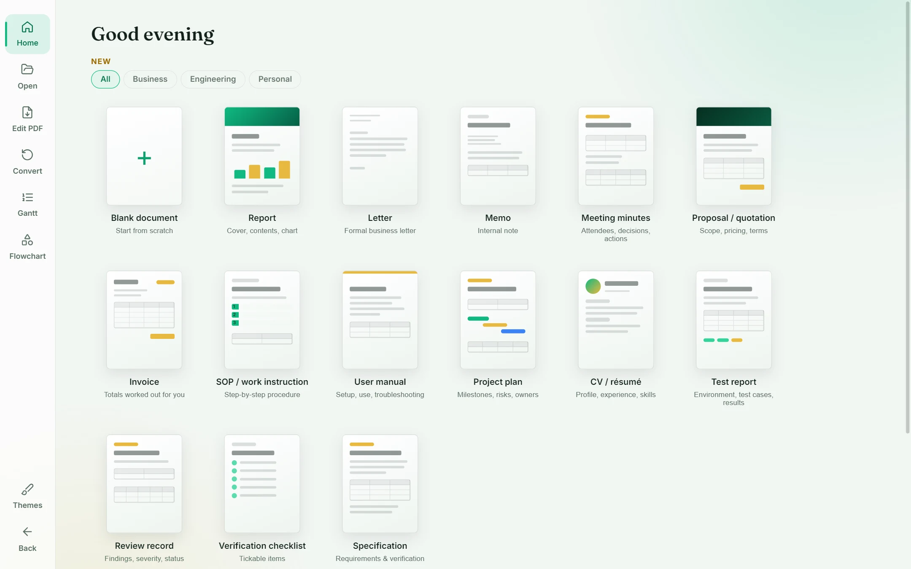

# Document Studio

A free Windows app for everyday documents — create from polished templates, edit any PDF, recognise text on scanned pages, convert files, and draw Gantt charts and flowcharts. Works offline; your files never leave your PC.

**Get it free on the Microsoft Store:** https://apps.microsoft.com/detail/9PN0DFDW0H8D
**Website:** https://designyash.github.io/document-studio/

## Features
- 14 document templates plus a blank page — reports, letters, invoices, minutes, CVs, proposals, manuals, test reports and more
- Edit PDFs: change existing text, add text, highlights, boxes, pictures and signatures, fill forms, reorder pages
- OCR for scanned PDFs, offline
- Convert between Word, PDF, Excel, PowerPoint, pictures, web pages, Markdown and text
- Gantt chart maker with phases, milestones and dependencies
- Flowchart maker (Mermaid) with a visual style editor
- Themes and gradient colour palettes

## Installing
Open the [Microsoft Store page](https://apps.microsoft.com/detail/9PN0DFDW0H8D) and press **Get**. Updates install automatically.

Some conversions (Word, Excel, PowerPoint) and “Edit as document” use Microsoft Office if it's installed.

## Made by
Designed and built by **Yash Deherkar**.

## Licences
Free to use. Built with open-source software — see [licenses.html](licenses.html). Privacy policy: [privacy.html](privacy.html) — the app collects no data.
